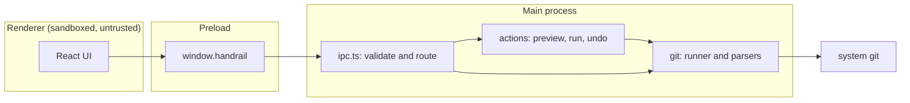
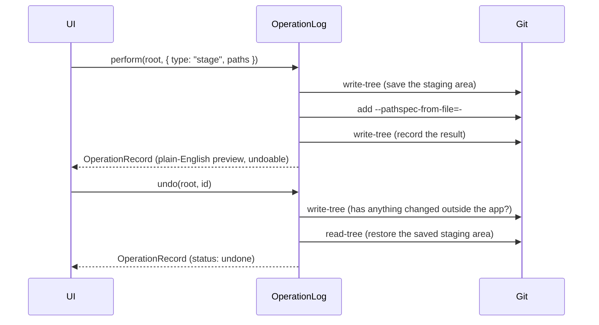

# Architecture

## Goals

1. Let someone use Git without knowing its commands.
2. Make every action understandable before it runs and reversible after.
3. Stay faithful to real Git: same results, same config, same hooks.

## Processes

- **Renderer** shows state and sends requests. It has no Node.js access and no direct file or Git access.
- **Preload** exposes one small object, `window.handrail`, typed by `HandrailApi` in `src/shared/ipc.ts`.
- **Main** owns everything with side effects. `ipc.ts` checks each argument, then calls the action
  layer or the Git layer.

`src/shared/` holds the types and the IPC contract. All three sides import it, so a change to a
request or a result is a compile error everywhere it matters.

## The action model

Everything the app does to a repository is an action:

An `ActionRequest` is plain data. `describeAction()` turns it into an `ActionPreview`: a title, a
sentence in plain English, and the Git commands that will run. The preview is generated without
touching the repository, so the UI can show it before anything happens.

### How undo works

Staging actions are undone by restoring the staging area from a saved copy:

- `git write-tree` saves the staging area as a tree object. It is cheap and Git keeps it.
- `git read-tree <tree>` puts it back. The working folder is not touched, so no edits are lost.

Before undoing, Handrail saves the staging area again and compares it with the copy taken right
after the action. If they differ, something else changed it (a terminal, an editor plugin), and
undoing would silently discard that work. Handrail refuses and says why.

Undo is last-in, first-out: you undo the newest action first.

Actions that move history (commit, merge, rebase) cannot be undone with a tree snapshot. They will
use the reflog instead, which is milestone 7 on the [roadmap](../ROADMAP.md).

## Key decisions

**Shell out to `git` instead of using a library.** Libraries such as isomorphic-git or libgit2
bindings reimplement Git and lag behind it. Handrail should respect the person's `.gitconfig`,
hooks, credential helpers, signing and attributes without extra work, so it runs the real thing.
The cost is parsing text output, which is why the parsers are strict and well tested.

**Parse porcelain output only.** `status --porcelain=v2 -z` and a fixed `log --format` are designed
to be machine-read and stay stable across Git versions. File names can contain spaces, quotes and
non-ASCII characters, so `-z` (NUL-separated, never quoted) is used everywhere it exists.

**Pass paths on stdin and treat them literally.** Staging uses `--pathspec-from-file=- --pathspec-file-nul`
so thousands of files cannot overflow the command-line limit (a real problem on Windows), and
`--literal-pathspecs` so a file called `*` or `:(top)x` is never read as a pattern. Both are
covered by tests.

**One Git command at a time per repository.** Git guards the index with a lock file, and two
commands touching the same repository can fail with `index.lock exists`. `GitRunner` queues
commands per directory. Different repositories run in parallel.

**Stable, non-interactive environment.** Every command runs with colour off, English messages,
`GIT_TERMINAL_PROMPT=0` (never wait for a password prompt that cannot be answered) and
`GIT_OPTIONAL_LOCKS=0` (so background status refreshes do not fight with real work).

## Security model

The renderer is treated as untrusted, because it renders data from repositories (file names, commit
messages) that anyone can influence.

- `contextIsolation: true`, `sandbox: true`, `nodeIntegration: false`.
- A strict Content-Security-Policy in `index.html`. The dev server relaxes it during `npm run dev`
  only (see `electron.vite.config.ts`).
- The renderer can only act on repositories the person opened through the folder picker in the
  current session. `ipc.ts` keeps that list and rejects everything else.
- Every IPC argument is validated in `ipc.ts` before use.
- Git is started with an argument array, never through a shell, so file names cannot inject commands.
- The window cannot open new windows or navigate away. `https://` links open in the system browser.
- Handrail stores no credentials. Authentication is left to Git's credential helper.

## Known limitations

These are deliberate for now, and tracked on the roadmap.

- The operation log is kept in memory and is lost when the app closes.
- The view refreshes when the window regains focus, not by watching the file system.
- Because commands are queued per repository, a slow command delays others on the same repository.
- Untracked folders are shown collapsed (`notes/`), as Git reports them by default.
- Undo covers the staging area only. Undoing commits, merges and rebases is milestone 7.
- The UI has no automated tests yet. The main process and Git layer do (milestone 9).
